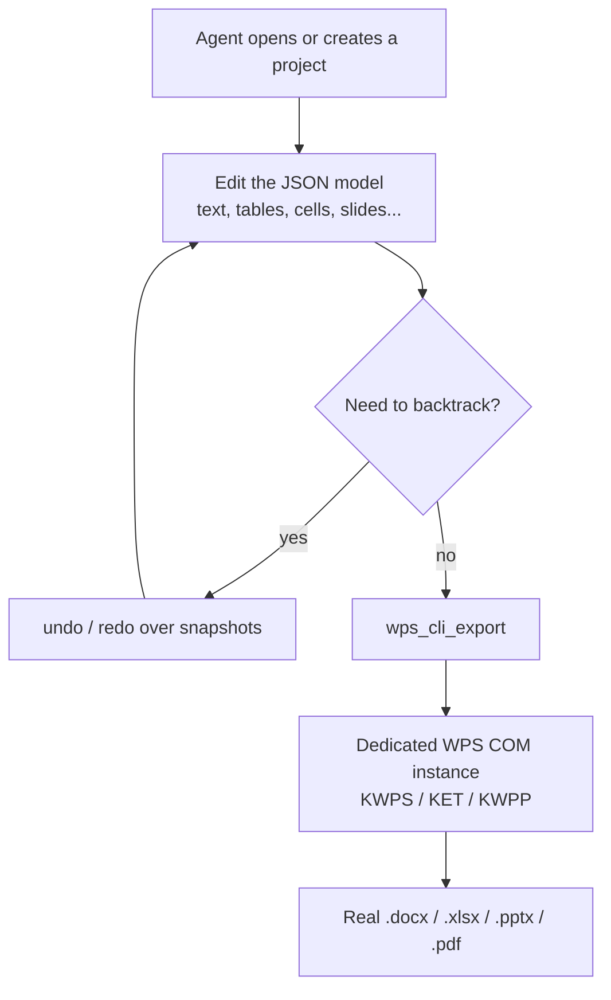

<div align="center">

# 📄 WPS Document MCP

**Generate Word, Excel, PowerPoint and PDF files on Windows through WPS COM — driven by a stdio MCP server for AI agents.**

Build a document as a JSON model, then export it to a real `.docx` / `.xlsx` / `.pptx` / `.pdf` in one step.

[](LICENSE)
[](https://www.python.org/)
[](#requirements)
[](https://modelcontextprotocol.io/)

[English](README.md) · [简体中文](README_zh-CN.md)

</div>

---

## Why this project?

Letting an AI agent produce Office documents usually means fragile UI automation (clicking ribbons and menus), or writing a file directly and hoping the layout survives. This server takes a different path:

1. The agent builds a **persistent JSON document model** — paragraphs, headings, tables, images, cells, formulas, slides, shapes — through small, well-typed tools.
2. When the model is complete, a single export call drives the **locally installed WPS Office via COM** to render a genuine Office file (or PDF).

You edit data, not a live open document. Every change is snapshotted (30-step undo/redo), and the exporter never force-closes your existing WPS windows.

- **24 structured MCP tools** across projects, Word, Excel, PowerPoint and export.
- **Safe by design** — no `taskkill`, no reading or mutating existing Office files, destructive deletes require an explicit `confirm`.
- **Clean stdio** — logs go to stderr only; the MCP channel is always pure UTF-8 JSON.
- **Deterministic storage** — projects are atomic JSON files, with an overridable workspace location.

> **Note:** This server targets **Windows x64 with WPS Office installed**. The COM export cannot run on other operating systems; the JSON model layer can still be exercised offline for tests.

---

## Requirements

| Requirement | Version / detail |
|---|---|
| OS | Windows 10/11 x64 (WPS COM) |
| Python | 3.10+ |
| WPS Office | A locally installed copy (Writer / Spreadsheets / Presentation) |
| pywin32 | `pywin32>=305`, installed for the same Python that runs the server |
| MCP client | Any stdio-compatible client (Claude Desktop, Cursor, custom agents) |

Install the Windows dependency:

```powershell
python -m pip install -r requirements.txt
```

---

## Tools (24)

### Project management (6)

| Tool | Purpose |
|---|---|
| `wps_cli_project_create` | Create a persistent project; `doc_type` = `writer` / `calc` / `impress` |
| `wps_cli_project_list` | List projects in the workspace |
| `wps_cli_project_info` | Get a project summary or the full JSON model |
| `wps_cli_project_delete` | Permanently delete a project (requires `confirm=true`) |
| `wps_cli_undo` / `wps_cli_redo` | Step through the last 30 model snapshots |

### Word / Writer (6)

| Tool | Purpose |
|---|---|
| `wps_cli_writer_add_text` | Append a paragraph or heading (level, size, font, color, bold, alignment) |
| `wps_cli_writer_add_table` | Add a table with optional 2-D data |
| `wps_cli_writer_add_image` | Reference a local image, with optional size |
| `wps_cli_writer_page_break` | Append a page break |
| `wps_cli_writer_find_replace` | Find/replace inside the text model |
| `wps_cli_writer_list` | List the Word content model |

### Excel / Calc (6)

| Tool | Purpose |
|---|---|
| `wps_cli_calc_set_cell` | Set a cell value or formula |
| `wps_cli_calc_set_range` | Fill a contiguous range from a 2-D array |
| `wps_cli_calc_add_sheet` | Add a worksheet |
| `wps_cli_calc_merge` | Mark a range to merge |
| `wps_cli_calc_get_cell` | Read a cell value or formula |
| `wps_cli_calc_sheets` | List worksheets and non-empty cell counts |

### PowerPoint / Impress (5)

| Tool | Purpose |
|---|---|
| `wps_cli_ppt_add_slide` | Add a slide (title, content, optional background) |
| `wps_cli_ppt_add_text` | Add a positioned text box |
| `wps_cli_ppt_add_shape` | Add a rectangle / rounded rectangle / ellipse |
| `wps_cli_ppt_add_image` | Add a positioned local image |
| `wps_cli_ppt_list` | List slides with element counts |

### Export (1)

| Tool | Purpose |
|---|---|
| `wps_cli_export` | Render the model via WPS COM to `docx` / `xlsx` / `pptx` / `pdf` |

---

## How it works



The exporter uses a separate COM instance (`DispatchEx`) whenever the installed WPS allows it, so your own work is left untouched; it only falls back to an attached instance without ever calling `Quit` on it.

---

## MCP client configuration

Point your client at `launcher.py` using the **absolute path** on your machine:

```json
{
  "mcpServers": {
    "wps-document": {
      "command": "python",
      "args": ["C:\\absolute\\path\\to\\cli-anything-wps-mcp\\launcher.py"]
    }
  }
}
```

- Use double backslashes in JSON on Windows. If `python` is not on `PATH`, set `command` to the full path of your Python executable.
- Projects are stored under `%LOCALAPPDATA%\cli-anything-wps\projects` by default. Override the location with the `WPS_CLI_WORKSPACE` environment variable.

### Typical agent flow

1. `wps_cli_project_create` with `doc_type` and `name` → keep the returned `project_id`.
2. Add content with the `writer_*` / `calc_*` / `ppt_*` tools.
3. `wps_cli_export` with an `output_path`, `format`, and `overwrite` if needed.

---

## Troubleshooting

| Problem | Check / fix |
|---|---|
| `本 MCP 只支持 Windows x86_64。` | The server only runs on Windows x64; run it there. |
| `缺少 pywin32` | Install it with the **same** Python: `python -m pip install pywin32`. |
| WPS COM export fails | Confirm WPS is installed and the same user can open it interactively; check COM registration and the desktop session. |
| No file produced / zero bytes | The exporter verifies the output exists and is non-empty; retry and check the WPS edition's COM support. |
| File already exists | Pass `overwrite=true`, or choose a different `output_path`. |
| Want projects elsewhere | Set `WPS_CLI_WORKSPACE` to a writable directory. |

---

## Acknowledgements

This server is adapted from the open-source [`harness-anything`](https://github.com/yb2460/harness-anything) project (the `cli_anything/wps` document-orchestration approach), streamlined into a standalone stdio MCP server.

## License

[MIT](LICENSE)
