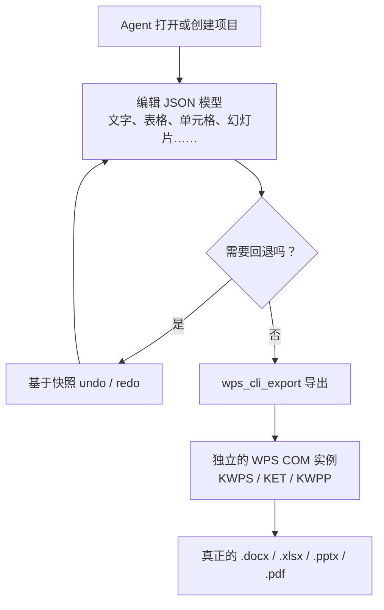

<div align="center">

# 📄 WPS 文档生成 MCP

**在 Windows 上通过 WPS COM 生成 Word、Excel、PowerPoint 和 PDF 文件 —— 由面向 AI Agent 的 stdio MCP 服务器驱动。**

先把文档构建成 JSON 模型，再一步导出为真正的 `.docx` / `.xlsx` / `.pptx` / `.pdf`。

[](LICENSE)
[](https://www.python.org/)
[](#环境要求)
[](https://modelcontextprotocol.io/)

[English](README.md) · [简体中文](README_zh-CN.md)

</div>

---

## 为什么需要这个项目？

让 AI Agent 生成 Office 文档，通常要么靠脆弱的界面自动化（点菜单、点功能区），要么直接写文件、却难保版式正确。本服务器换了一条路：

1. Agent 通过小而类型明确的工具，构建一个**持久化的 JSON 文档模型** —— 段落、标题、表格、图片、单元格、公式、幻灯片、形状。
2. 模型完成后，一次导出调用驱动**本机已安装的 WPS（通过 COM）**，渲染出真正的 Office 文件（或 PDF）。

你编辑的是数据，而不是一个打开着的文档。每次改动都会留快照（支持 30 步撤销/重做），导出器也绝不会强制关闭你已打开的 WPS 窗口。

- **24 个结构化 MCP 工具**，覆盖项目、Word、Excel、PowerPoint 与导出。
- **安全优先** —— 不 `taskkill`、不读取或改动已有 Office 文件；删除等破坏性操作必须显式 `confirm`。
- **干净的 stdio** —— 日志只走 stderr，MCP 通道始终是纯 UTF-8 JSON。
- **确定性存储** —— 项目是原子写入的 JSON 文件，工作目录可自定义。

> **注意：** 本服务器面向**安装了 WPS Office 的 Windows x64**。COM 导出无法在其他操作系统运行；JSON 模型层仍可离线用于测试。

---

## 环境要求

| 要求 | 版本 / 说明 |
|---|---|
| 操作系统 | Windows 10/11 x64（WPS COM） |
| Python | 3.10+ |
| WPS Office | 本机已安装（文字 / 表格 / 演示） |
| pywin32 | `pywin32>=305`，用运行服务器的同一个 Python 安装 |
| MCP 客户端 | 任意兼容 stdio 的客户端（Claude Desktop、Cursor、自研 Agent） |

安装 Windows 依赖：

```powershell
python -m pip install -r requirements.txt
```

---

## 工具列表（24 个）

### 项目管理（6 个）

| 工具 | 用途 |
|---|---|
| `wps_cli_project_create` | 创建持久化项目；`doc_type` = `writer` / `calc` / `impress` |
| `wps_cli_project_list` | 列出工作目录中的项目 |
| `wps_cli_project_info` | 查看项目摘要或完整 JSON 模型 |
| `wps_cli_project_delete` | 永久删除项目（需 `confirm=true`） |
| `wps_cli_undo` / `wps_cli_redo` | 在最近 30 个快照间前进/后退 |

### Word 文字（6 个）

| 工具 | 用途 |
|---|---|
| `wps_cli_writer_add_text` | 追加段落或标题（级别、字号、字体、颜色、加粗、对齐） |
| `wps_cli_writer_add_table` | 添加表格，可填充二维数据 |
| `wps_cli_writer_add_image` | 引用本机图片，可设尺寸 |
| `wps_cli_writer_page_break` | 追加分页符 |
| `wps_cli_writer_find_replace` | 在文本模型中查找替换 |
| `wps_cli_writer_list` | 列出 Word 内容模型 |

### Excel 表格（6 个）

| 工具 | 用途 |
|---|---|
| `wps_cli_calc_set_cell` | 设置单元格值或公式 |
| `wps_cli_calc_set_range` | 用二维数组填充连续区域 |
| `wps_cli_calc_add_sheet` | 新增工作表 |
| `wps_cli_calc_merge` | 标记区域合并 |
| `wps_cli_calc_get_cell` | 读取单元格值或公式 |
| `wps_cli_calc_sheets` | 列出工作表及非空单元格数 |

### PowerPoint 演示（5 个）

| 工具 | 用途 |
|---|---|
| `wps_cli_ppt_add_slide` | 新增幻灯片（标题、正文、可选背景） |
| `wps_cli_ppt_add_text` | 添加带定位的文本框 |
| `wps_cli_ppt_add_shape` | 添加矩形 / 圆角矩形 / 椭圆 |
| `wps_cli_ppt_add_image` | 添加带定位的本机图片 |
| `wps_cli_ppt_list` | 列出幻灯片及元素数量 |

### 导出（1 个）

| 工具 | 用途 |
|---|---|
| `wps_cli_export` | 通过 WPS COM 把模型渲染为 `docx` / `xlsx` / `pptx` / `pdf` |

---

## 工作原理



导出器在 WPS 允许时使用独立 COM 实例（`DispatchEx`），不影响你自己的工作；只有在无法独立实例时才附加到已有实例，且绝不会对它调用 `Quit`。

---

## MCP 客户端配置

用你机器上的**绝对路径**把客户端指向 `launcher.py`：

```json
{
  "mcpServers": {
    "wps-document": {
      "command": "python",
      "args": ["C:\\absolute\\path\\to\\cli-anything-wps-mcp\\launcher.py"]
    }
  }
}
```

- Windows 的 JSON 中使用双反斜杠。如果 `python` 不在 `PATH`，把 `command` 改成 Python 可执行文件的完整路径。
- 项目默认保存在 `%LOCALAPPDATA%\cli-anything-wps\projects`。可用环境变量 `WPS_CLI_WORKSPACE` 覆盖保存位置。

### Agent 典型流程

1. `wps_cli_project_create`，传入 `doc_type` 和 `name` → 保存返回的 `project_id`。
2. 用 `writer_*` / `calc_*` / `ppt_*` 工具添加内容。
3. `wps_cli_export`，传入 `output_path`、`format`，需要时加 `overwrite`。

---

## 常见问题

| 问题 | 检查 / 解决 |
|---|---|
| `本 MCP 只支持 Windows x86_64。` | 服务器只能在 Windows x64 运行，请在该环境启动。 |
| `缺少 pywin32` | 用**同一个** Python 安装：`python -m pip install pywin32`。 |
| WPS COM 导出失败 | 确认已安装 WPS、同一用户可正常交互打开；检查 COM 注册与桌面会话。 |
| 未生成文件 / 文件为 0 字节 | 导出器会校验输出存在且非空；请重试并检查该 WPS 版本的 COM 支持。 |
| 文件已存在 | 传 `overwrite=true`，或换一个 `output_path`。 |
| 想把项目放到别处 | 把 `WPS_CLI_WORKSPACE` 设为一个可写目录。 |

---

## 致谢

本服务器改编自开源项目 [`harness-anything`](https://github.com/yb2460/harness-anything)（其中 `cli_anything/wps` 的文档编排思路），精简为独立的 stdio MCP 服务器。

## 许可证

[MIT](LICENSE)
